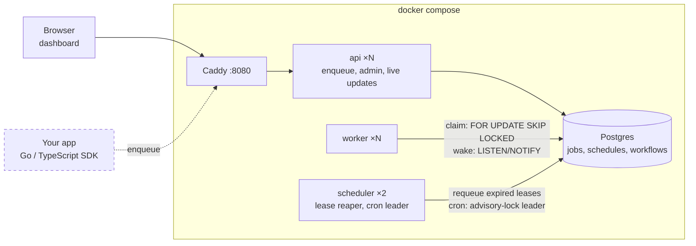
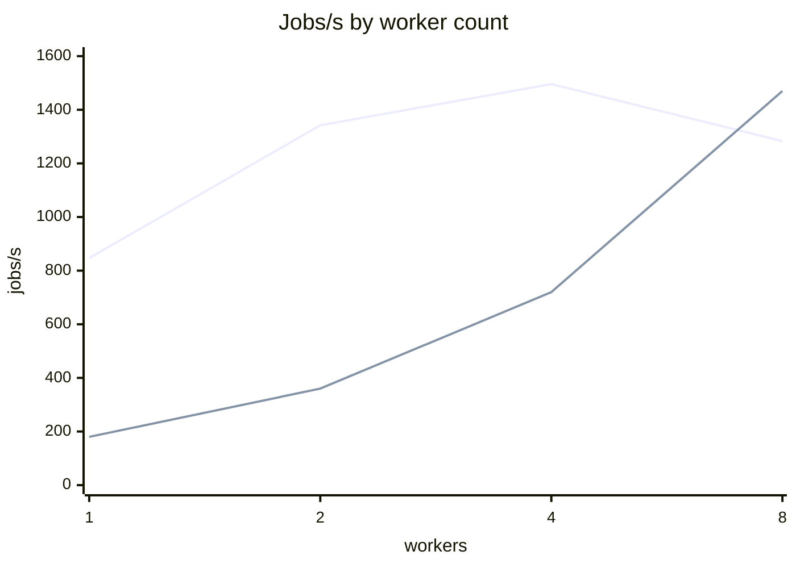

# Job queue and workflow engine

A Postgres-backed job queue with retries, cron schedules, multi-step workflows and a live dashboard.

The step-by-step build plan is in [PLAN.md](PLAN.md).

> **Status:** phase 7 of 8, scale and retention. Jobs run with leases, retries with backoff, a dead-letter state and
> graceful shutdown; cron schedules run on a leader-elected scheduler; workflows run as DAGs with compensation;
> queues have concurrency and rate limits; a live dashboard shows and controls it all.
> The dashboard and `/api/admin/*` need `ADMIN_TOKEN`. The app-facing endpoints (enqueue, job status, start a
> run) have no authentication: keep them on a private network.

## Run it

```bash
git clone --recurse-submodules https://github.com/gonzalo-gigena/job-queue.git
cd job-queue
cp .env.example .env
docker compose up --watch
```

Open http://localhost:8080 for the dashboard (any user name, password `ADMIN_TOKEN` from `.env`). Needs only Docker with Compose v2. Code changes reload
automatically (Compose Watch). On Windows, clone inside the WSL filesystem, not `/mnt/c`.

Cloned without `--recurse-submodules`? Run `git submodule update --init`.

## Use it

```bash
curl -X POST localhost:8080/api/jobs -d '{"kind":"sleep","payload":{"ms":200},"idempotency_key":"demo-1"}'
curl localhost:8080/api/jobs/1
```

`POST /api/jobs` returns `201 {"id":…}`, or `200 {"id":…,"duplicate":true}` when the queue already has that
`idempotency_key`.

| Field | Default | Notes |
|---|---|---|
| `kind` | required | Built in: `noop`, `sleep` with `{"ms":…}`, and `effect` (the idempotent pattern below; `{"fail":true}` always fails). An unknown kind fails the job. |
| `payload` | `{}` | Any JSON, up to 1 MB |
| `queue` | `default` | `[a-z0-9_]`, up to 50 characters. Workers serve the queues in `WORKER_QUEUES`. |
| `priority` | `0` | Higher runs first |
| `run_at` | now | RFC 3339 time. A future job starts within about 1 s of it (the poll interval). |
| `max_attempts` | `5` | Runs before the job is `dead`, counting crashes |
| `idempotency_key` | none | 1 to 255 bytes, unique per queue |

A worker runs one job at a time, for up to 5 minutes. Add workers with `--scale worker=N`.

### Dashboard

http://localhost:8080 shows each queue (ready, scheduled, running, dead, done per minute, failure rate over
5 minutes, age of the oldest ready job, limits) with pause/resume, and the newest 50 jobs filtered by status,
queue and kind, with retry and discard for dead jobs and cancel for queued or running ones. Click an id for
the payload and last error. The *+20 jobs* and *+5 failing* buttons enqueue demo work.

Live updates are Server-Sent Events from `GET /api/admin/stream`: each open dashboard makes the api query
Postgres once a second. That's fine for a few viewers; past that, poll once per replica and fan out.

Everything under `/api/admin/` takes HTTP basic auth with `ADMIN_TOKEN` as the password, or
`Authorization: Bearer $ADMIN_TOKEN`. Basic auth means the browser prompts once and attaches it to every
`fetch` and `EventSource`, with no login page or session to build. Cancelling a running job needs no message to
its worker: the worker's next heartbeat (within 10 s) matches 0 rows, since the fence requires `running`, and it
abandons the job.

### Cron schedules

```bash
curl -u admin:$ADMIN_TOKEN -X PUT localhost:8080/api/admin/schedules/nightly-report \
  -d '{"cron":"0 3 * * *","timezone":"Europe/Madrid","kind":"sleep","payload":{"ms":100}}'
curl -u admin:$ADMIN_TOKEN localhost:8080/api/admin/schedules
curl -u admin:$ADMIN_TOKEN -X DELETE localhost:8080/api/admin/schedules/nightly-report
```

`cron` is the standard 5 fields, an optional leading seconds field (`*/10 * * * * *`), or `@daily`-style
descriptors. Times are wall-clock in `timezone` (default `UTC`), so `0 9 * * *` stays at 09:00 local across
DST changes. `queue`, `kind` and `payload` are as for a job; `"enabled": false` pauses a schedule.

Two `scheduler` replicas run; the one holding `pg_try_advisory_lock` on a direct connection is the leader and
checks schedules every second. If it dies, Postgres closes its session, the lock frees, and the standby takes
over within about a second. Each run is enqueued with the idempotency key `schedule_id:time`, and runs missed
while no leader was up are enqueued on takeover (up to 100 per schedule per tick), so a failover neither skips
nor duplicates a run.

### Queue limits

```bash
curl -u admin:$ADMIN_TOKEN -X PUT localhost:8080/api/admin/queues/emails/limits -d '{"max_running":5,"rate_per_sec":10,"burst":20}'
curl -u admin:$ADMIN_TOKEN -X DELETE localhost:8080/api/admin/queues/emails/limits   # unlimited again
```

`max_running` caps how many of the queue's jobs run at once across every worker; `rate_per_sec` caps how many
start per second, with a token bucket of `burst` (default `max(1, rate_per_sec)`). Either can be `null`. A worker
that finds the bucket empty sleeps until the next token is due rather than the 1 s poll. Workers with several
queues in `WORKER_QUEUES` try them in the order listed.

### Workflows

A workflow is a DAG of steps defined in Go (`apps/api/workflow.go`). Each step is an ordinary job of kind
`wf:<workflow>.<step>`, so it gets leases, retries and fencing, and reads its parents' outputs:

```go
newWorkflow("signup").
	step("create", createUser).
	step("email", sendWelcome, "create"). // runs once "create" succeeded
	step("crm", addToCRM, "create").
	step("done", markDone, "email", "crm"). // fan-in
	onFailure("cleanup", deleteUser)       // compensation: only if some step fails for good
```

```bash
curl -X POST localhost:8080/api/workflows/demo/runs -d '{"input":{"n":1}}'   # → {"id":…}
curl localhost:8080/api/workflows/runs/1   # run status, and each step's status, output and job
```

The built-in `demo` workflow is `a → b, c, d → e` (input `{"n":…, "ms":…, "fail":"<step>"}`).

When a step's job succeeds, its output, the run's state and the jobs for the steps it unblocks commit in the
same transaction as the job's completion, holding the run's row lock (`SELECT … FOR UPDATE`). When a step's job
goes `dead` (by error or by crashing its worker), the run fails, steps that hadn't started are `skipped`, and
the `onFailure` steps run with every succeeded step's output, so they know what to undo. Steps already running
finish. A dead step's job can't be retried on its own, since its run has already compensated.

### When things fail

Delivery is **at-least-once**: a job can run more than once, so handlers must be idempotent.

- **Handler error:** the job goes back to `queued` with a backoff, `run_at = now() + min(1 h, 1 s·2^attempt)·rand()`,
  and to `dead` after `max_attempts` runs. `last_error` keeps the latest error.
- **Worker crash:** a claim is a 30 s lease, and the worker extends it every 10 s. The `scheduler`'s reaper
  checks every 5 s and puts jobs whose lease expired back to `queued`, or to `dead` if that was their last
  attempt, so a job that crashes its worker can't loop forever. A crashed worker's job restarts 30–35 s later.
- **Zombie worker** (paused, or cut off from Postgres while its lease expired): every write it makes to the job
  checks `(id, worker_id, attempts)`. Once the job was reclaimed, those writes change 0 rows, the worker abandons
  the job, and its result is dropped.
- **Deploy (SIGTERM):** the worker stops claiming, gives the in-flight job up to 25 s to finish, then cancels it
  and hands it back to `queued` without using up an attempt.
- **Dead jobs:** `POST /api/admin/jobs/{id}/retry` requeues one with fresh attempts; `POST /api/admin/jobs/{id}/discard`
  marks it `cancelled`. The dashboard has buttons for both.

The idempotent pattern, as the `effect` kind does it: record the job in `processed` in the same transaction
as the side effect, and skip the side effect if it is already there.

```go
pgx.BeginFunc(ctx, db, func(tx pgx.Tx) error {
	tag, err := tx.Exec(ctx, `INSERT INTO processed (job_id) VALUES ($1) ON CONFLICT DO NOTHING`, j.ID)
	if err != nil || tag.RowsAffected() == 0 {
		return err // an earlier run already did it
	}
	_, err = tx.Exec(ctx, `INSERT INTO effects (job_id) VALUES ($1)`, j.ID) // the side effect
	return err
})
```

This works when the side effect is in the same database. For an external call (email, payment), pass the job
id as the provider's idempotency key instead.

## Everyday commands

| What | Command |
|---|---|
| Seed demo data | `docker compose run --rm seed` |
| SQL shell | `docker compose exec db psql -U app app` |
| Scale the api | `docker compose up -d --scale api=3` |
| Scale the workers | `docker compose up -d --scale worker=3`, check with `sh infra/worker-smoke.sh 3` |
| Scheduler failover drill | `sh infra/scheduler-failover.sh` (SIGKILLs the leader) |
| Workflow chaos: kill workers mid-DAG | `sh infra/workflow-chaos.sh 4` (300 runs of `demo`) |
| Limits across 5 workers | `sh infra/limits-test.sh 5` |
| Chaos test: kill workers mid-run | `sh infra/chaos-test.sh 4` (10,000 jobs, about 1–4 minutes) |
| Lint migrations | `sh common/scripts/check-migrations.sh` |
| Throughput at 1, 2, 4, 8 workers | `sh infra/throughput.sh` |
| Measure enqueue → handled | `docker compose --profile loadtest run --rm k6 run /scripts/latency.js` |
| Prove scaling works | `sh common/scripts/smoke.sh 3` |
| The api replica check from CI | `sh common/scripts/ci-stack.sh 3` (ends with `down -v`) |
| Load test at 1, 2, 4 replicas | `sh common/scripts/scale.sh` |
| Metrics (Prometheus) | `docker compose --profile observability up -d`, then http://localhost:9090 |
| Tests, against real Postgres | `docker compose run --rm test` |
| New migration | add `infra/db/migrations/00000N_name.up.sql` + `.down.sql` (start with `SET lock_timeout`; `CONCURRENTLY` alone in its file), restart |
| Update shared code | `git submodule update --remote common` |
| Reset everything | `docker compose down -v` |

## Architecture



Solid boxes and arrows run today. Dashed ones are planned in [PLAN.md](PLAN.md).

Postgres is the only stateful service. Workers claim jobs with `FOR UPDATE SKIP LOCKED`, so any number of them pull from one table without waiting on each other.

## Stack

- **api:** Go 1.27 (`net/http` + `pgx` + Prometheus client), distroless runtime image. Stateless, so it scales with `--scale api=N`.
- **worker:** the same binary run as `api worker`. Its pool goes through PgBouncer (`DATABASE_URL`); `LISTEN` uses
  one direct connection (`DIRECT_DATABASE_URL`). After a NOTIFY wake-up it waits 0–20 ms at random, so idle
  workers don't all hit the dequeue query in the same instant.
- **PgBouncer 1.24:** transaction pooling for every pool (api, worker, scheduler), 20 server connections.
  1.21+ tracks protocol-level prepared statements (`max_prepared_statements`), so pgx's statement cache works
  through it. Session state can't go through it: `LISTEN` and the scheduler's advisory lock use direct connections.
- **scheduler:** the same binary run as `api scheduler`, two replicas. Both run the lease reaper (safe
  concurrently); the advisory-lock leader also runs cron. Timezones are embedded (`time/tzdata`), since the
  distroless image has no zoneinfo.
- **Caddy:** the only service with a host port. It load-balances `/api/*` across every
  replica (`import lb api 8080`, from common) and serves `apps/web`.
- **Postgres 18:** migrations run once before the api starts (`golang-migrate`).
- **Retention:** the scheduler leader moves `succeeded` and `cancelled` jobs older than 1 hour to `jobs_archive`
  (5,000 per statement, `DELETE … RETURNING` into `INSERT`), once a minute. `jobs_archive` is partitioned by day
  on `finished_at`; the leader creates partitions two days ahead and drops those older than 7 days, and prunes
  `processed` markers of the same age. `dead` jobs stay until retried or discarded. An archived job's
  idempotency key is free again, so keys deduplicate for an hour, not forever.
- **Autovacuum:** `jobs` vacuums at 1% dead rows (`autovacuum_vacuum_scale_factor = 0.01`, and the same for
  inserts), not the default 20%: every row is updated several times and then deleted, and a bloated `jobs`
  slows every claim.
- **common/:** git submodule with the shared fakes, scripts, Caddy snippet and Prometheus.
  See [portfolio-common](common/README.md).

## Deploy (one VM)

```bash
docker compose -f compose.yaml -f compose.prod.yaml up -d
```

The server's `.env` needs `SITE_ADDRESS`, `IMAGE_REPO`, `TAG`, a strong password, and no `fakes`
profile. Caddy gets TLS automatically. CI pushes multi-arch images to GHCR on every merge to `main`.

## Decisions & tradeoffs

| Decision | Chosen | Rejected | Why, and what it costs |
|---|---|---|---|
| Broker | Postgres only | Redis (Sidekiq-style), RabbitMQ, Kafka | A job can be enqueued in the same transaction as the app's own write, so it exists exactly when the data does. One stateful service to run and back up. Cost: one Postgres node caps throughput, roughly thousands of jobs/s depending on job size. |
| Claiming jobs | One `UPDATE … WHERE id = ANY(ARRAY(SELECT … FOR UPDATE SKIP LOCKED LIMIT n))` | `SELECT` then `UPDATE`, an advisory lock per job, or the common `id IN (SELECT …)` | One round trip, and concurrent workers skip rows another worker holds instead of queueing behind them. `IN` looks the same, but Postgres may re-scan it and lock more rows each time: on 18 it claimed 5 jobs with `LIMIT 1`. `ARRAY(…)` is evaluated once. |
| Dequeue index | One claim statement per queue (`queue = $1`), queues tried in the order listed | `queue = ANY($1)` | With `ANY`, Postgres sorts every queued row on each claim (about 12 ms at 50,000 queued) instead of reading the partial index in order (under 1 ms). Cost: `priority` orders jobs within a queue, not across a worker's queues. |
| Concurrency limit | Lock the queue's `queue_limits` row (`FOR UPDATE`), then count running jobs in the next statement, in one transaction | Counting inside the claim query | Concurrent workers all see the same count. The count also can't be in the locking statement: under READ COMMITTED its snapshot predates the lock wait. Without the lock, `TestConcurrencyLimitHoldsAcrossWorkers` saw 16 running against a limit of 3. Cost: claims on a limited queue are serialized, and every claim is now a 3–4 round-trip transaction. |
| Rate limit | Token bucket in the same `queue_limits` row, refilled lazily at claim time; an empty bucket tells the worker when to retry | A counter per second, or a Redis bucket | No refill process, and it rides the lock the concurrency limit already takes. Sleeping until the next token (not the 1 s poll) took 5 workers from 4/s to 18.9/s against a 20/s limit, never over 20 in any 1 s window. |
| Waking workers | `LISTEN/NOTIFY` in the enqueue transaction, plus a 1 s poll | Polling only | Jobs start within milliseconds, and polling catches a missed notification. Cost: `LISTEN` needs a direct connection per worker, not PgBouncer. |
| Delivery guarantee | At-least-once, with leases and a heartbeat | Claiming exactly-once | Exactly-once isn't possible once a worker can die mid-job. Leases fence out zombie workers, and handlers must be idempotent: write a `processed(job_id)` row in the same transaction as the side effect. The chaos test kills every worker 8 times during 10,000 jobs and still gets exactly 10,000 effects. |
| Fencing token | `attempts`, checked with `worker_id` on every heartbeat and completion | `worker_id` alone | A worker's id is its hostname, and a restarted container keeps it. With `worker_id` alone, a zombie could complete the job its own restarted replica had just reclaimed. `attempts` goes up on every claim, so it is never reused. |
| Lease length | 30 s lease, 10 s heartbeat, reaper every 5 s | A short lease without heartbeats | A heartbeat lets a job run longer than its lease, and two missed beats are tolerated. Cost: a crashed worker's job waits 30–35 s before it runs again. |
| Retries | Exponential backoff with full jitter, `min(1 h, 1 s·2^attempt)·rand()`, then `dead` | A fixed delay | Jitter stops failed jobs from retrying in lockstep against a struggling dependency. A crash uses an attempt too, so a job that kills its worker ends in `dead`. |
| Shutdown | Stop claiming, 25 s to finish, then cancel and release the job, giving the attempt back | Waiting for the job, or dropping it | Inside compose's 35 s grace period, so the job is handed back rather than left for the reaper. A deploy doesn't push a job toward `dead`. |
| Live dashboard | Server-Sent Events, each stream polling Postgres every 1 s | WebSockets, `LISTEN` per viewer | One-way updates are all it needs, `EventSource` reconnects by itself, and Caddy passes the stream through. Cost: one overview query per viewer per second. |
| Admin auth | HTTP basic auth (password `ADMIN_TOKEN`) or a bearer token on `/api/admin/*`, constant-time compare | No auth, or a login page with sessions | An open admin panel can cancel and retry anyone's jobs. Basic auth is native in the browser, so no login page. Cost: one shared secret, no per-user audit. |
| Retention | Archive finished jobs to a day-partitioned `jobs_archive`, drop partitions after 7 days | Partitioning `jobs` itself, or `DELETE` in place | A unique index on a partitioned table must include the partition key, which would break `UNIQUE (queue, idempotency_key)`. Dropping a partition is instant and leaves no dead rows. Cost: idempotency keys last 1 hour (the archive delay); a separate `idempotency_keys` table would keep them longer. |
| Connection pooling | PgBouncer in transaction mode for pools, direct connections for `LISTEN` and the leader lock | Direct connections everywhere | 8 workers + api + 2 schedulers would hold ~100 server connections; through PgBouncer they share 20. Cost: one more hop per round trip, and PgBouncer is single-threaded (31% of a core at the no-op ceiling). |
| NOTIFY jitter | 0–20 ms random delay after a wake-up | PLAN.md's 0–50 ms, or none | Spreads idle workers' claims. At 50 ms, p95 enqueue → handled went from 2 ms to 34 ms with 3 workers, and one worker would sit at the 50 ms target; at 20 ms it is 18 ms. |
| Reaper | One `UPDATE … SKIP LOCKED` on a partial index of running jobs, on every scheduler replica | Only the leader reaps | Concurrent reapers each take different rows, so it needs no leader. The index only holds running jobs, so it stays tiny however large `jobs` grows. |
| Scheduler leader | `pg_try_advisory_lock` on a direct connection, standbys retry every 1 s | etcd or Raft, or one scheduler | If the leader dies, its connection closes and the lock frees: the CI drill SIGKILLs the leader container and the standby leads 1 s later. Each run's idempotency key (`schedule_id:time`) and `FOR UPDATE SKIP LOCKED` on the schedule row make a brief two-leader overlap harmless. Cost: a leader cut off by a network partition (not killed) holds the lock until TCP notices. |
| Missed cron runs | Enqueue every missed run on takeover, 100 per schedule per tick | Skip to the next future run | The failover test demands no skipped run. Cost: after a long outage a minutely schedule fires a burst of catch-up jobs; disable it first if that's wrong for the job. |
| Cron library | `robfig/cron/v3` evaluated in the schedule's `time.Location` | Computing in UTC | Wall-clock schedules keep their local hour across DST (tested on New York's 2026 spring-forward). |
| Workflow fan-in | Complete the step's job, save its output and enqueue its children in one transaction, holding the run's row lock | Separate updates, or no lock | A crash can't land between "step done" and "children enqueued". Without the lock, two parents finishing at once each see the other still running and the child never starts: removing `FOR UPDATE` makes `TestWorkflowFanOutFanIn` hang every time. Cost: steps of one run complete one at a time. |
| Workflow steps | Ordinary jobs, kind `wf:<workflow>.<step>`, idempotency key `wf:<run>:<step>` | A separate step executor | Steps inherit leases, retries, fencing and the dead-letter state. The key means a step is enqueued at most once per run even if its parents' completion is replayed. The chaos drill SIGKILLs every worker 4 times during 300 runs: all succeed with exactly 1,500 step jobs. |
| Workflow failure | The run fails, pending steps are skipped, `onFailure` steps run (saga) | Distributed transactions | Steps call external systems, which can't join a transaction. Compensation steps get every succeeded step's output. Cost: compensations must be idempotent too. |
| Packaging | One Go binary with `api`, `worker` and `scheduler` subcommands | A separate image per role | One Dockerfile, one image, and the same version everywhere. |
| Load balancing | Caddy `dynamic a` upstreams (the `lb` snippet in `common/`) | `reverse_proxy api:8080`, Traefik | Caddy re-reads Docker DNS every 5 s, so `--scale api=N` needs no config change and no Docker socket mount. A plain `reverse_proxy api:8080` is a single upstream to Caddy and doesn't reliably spread load. |
| Migrations | A one-shot `migrate` service that finishes before the api starts | Each replica migrating on boot | Replicas starting together would race on the same migration. |

Rows for parts that aren't built yet record the plan's choice. Each one gets confirmed or revised when that phase is built.

## Scaling

### Measured

**Enqueue → handled, idle queue.** `infra/loadtest/latency.js` sends 200 `noop` jobs, one at a time, 150–350 ms
apart, so every worker is asleep in `LISTEN` when a job arrives. *Handled* is `finished_at - created_at` on the
Postgres clock. *Round trip* is what a client sees through Caddy, from sending the POST to a polled GET that
says `succeeded`.

**On an idle system a job is handled 1 ms after enqueue at p50 and 2 ms at p95**, against a target of under
50 ms. That's [one CI run](https://github.com/gonzalo-gigena/job-queue/actions/runs/44981277382) at commit `14b00b3`, with 3 workers on a GitHub-hosted `ubuntu-26.04` amd64
runner that ran nothing else:

| | p50 | p95 | p99 | max |
|---|---|---|---|---|
| handled | 1 ms | 2 ms | 4 ms | 7 ms |
| round trip | 4 ms | 5 ms | 9 ms | 10 ms |

The script compares whole milliseconds, so each value is ±1 ms.

For comparison, under load on an Apple M1 laptop (8 CPUs, 8 GB for Docker). **This machine was not idle:** other projects' stacks shared
the Docker VM, one of them using up to 4 cores, and the host's load average was 12–21. All eight runs:

| workers | run | handled p50 | handled p95 | handled p99 | round trip p50 | round trip p95 |
|---|---|---|---|---|---|---|
| 1 | 1 | 3 ms | 22 ms | 54 ms | 8 ms | 40 ms |
| 1 | 2 | 3 ms | 12 ms | 26 ms | 8 ms | 22 ms |
| 1 | 3 | 10 ms | 59 ms | 121 ms | 23 ms | 127 ms |
| 1 | 4 | 7 ms | 27 ms | 40 ms | 17 ms | 51 ms |
| 3 | 1 | 8 ms | 24 ms | 33 ms | 16 ms | 47 ms |
| 3 | 2 | 24 ms | 88 ms | 103 ms | 38 ms | 100 ms |
| 3 | 3 | 12 ms | 75 ms | 110 ms | 23 ms | 91 ms |
| 3 | 4 | 7 ms | 47 ms | 111 ms | 17 ms | 81 ms |

The median stayed under 50 ms in every run. The p95 went over in three of the eight, so under heavy CPU
contention the target doesn't hold at p95. CI runs the same script on every PR and fails above 50 ms at p95.

**HTTP, from the skeleton:** k6 with 20 virtual users for 20 s against `GET /api/hello`, which reads one row from Postgres through Caddy. Run on an Apple M1 laptop with 8 CPUs and 8 GB given to Docker, with the dev override left out:

```bash
COMPOSE_FILE=compose.yaml sh common/scripts/scale.sh
```

| api replicas | req/s | p95 latency | failed |
|---|---|---|---|
| 1 | 13,526 | 3.09 ms | 0.00% |
| 2 | 14,438 | 2.96 ms | 0.00% |
| 4 | 14,468 | 3.06 ms | 0.00% |

4 replicas served 1.1× the requests of 1. One Go process already spreads across every core, and the run shares 8 CPUs with Caddy, Postgres and k6, so on one machine extra api replicas buy redundancy, not throughput. Replica counts matter for `worker`, which phase 7 measures.

**Chaos test.** `infra/chaos-test.sh 4` inserts 10,000 `effect` jobs (each sleeps 10 ms after its side effect)
for 4 workers, then 8 times waits 2–6 s, SIGKILLs every worker and restarts them 0–2 s later. In
[one CI run](https://github.com/gonzalo-gigena/job-queue/actions/runs/45093265380) at commit `b52ac04`: all 10,000
succeeded in 86 s, `effects` had exactly 10,000 rows, nothing was left `running`, and 27 jobs ran twice, all 27
requeued by the reaper after their lease expired. On the shared M1 laptop the same test took 211 s, with 18 jobs
run twice. CI runs it on every PR and fails on any duplicate or lost job.

### How each part scales

| Part | Scales by | Limit |
|---|---|---|
| `api` | `--scale api=N` (stateless) | PgBouncer's 20 server connections |
| `worker` | `--scale worker=N`, one job at a time each | Linear for jobs that do real work; no-op jobs top out at ~1,500/s (measured below). Per-queue limits hold across replicas. |
| `scheduler` | 2 replicas, one leader | The reaper runs on every replica. For cron, only the leader works and the standby takes over in about 1 s. |
| Postgres | One primary | The ceiling for the whole system |

**Throughput.** `sh infra/throughput.sh` inserts jobs into a running stack and divides by the time from the
first start to the last finish, on Postgres's clock: 5,000 no-op jobs, and 200 × workers jobs that sleep 50 ms.
One run on the shared Apple M1 laptop (8 CPUs for Docker, other projects' stacks running, load average 3–8),
through PgBouncer:

| workers | no-op jobs/s | 50 ms jobs/s | 50 ms ideal (20/s per worker) |
|---|---|---|---|
| 1 | 847 | 18 | 20 |
| 2 | 1,342 | 36 | 40 |
| 4 | 1,496 | 72 | 80 |
| 8 | 1,283 | 147 | 160 |



(The 50 ms line is ×10 so both fit one axis.)

**50 ms jobs scale linearly** to 8 workers, at 90–92% of ideal: the queue's overhead per job is about 5 ms.
**No-op jobs saturate at about 1,300–1,500 jobs/s, reached at 2–4 workers**, and 8 workers is slightly slower
than 4 (more contention at the head of the queue). At that point Postgres used about 0.8 of a core and PgBouncer
0.3, so it isn't CPU. Each job costs two commits (claim, complete) and about 7 round trips through PgBouncer.
With `synchronous_commit = off` the 4-worker no-op rate went from 1,496 to 1,870 jobs/s, so commit flushes are
about a fifth of the ceiling and round trips most of the rest.

### Where it breaks next

- **Past ~1,500 jobs/s on one node:** claim several jobs per round trip (`dequeue` already takes a limit) and run
  them concurrently in one worker, which divides the claim cost; then `synchronous_commit = off` for queues that
  can lose the last few hundred ms of completions on a crash (they'd just run again).
- **Past one Postgres node.** Shard queues across databases, or move to Kafka or NATS. Portfolio-scale load never gets there.
