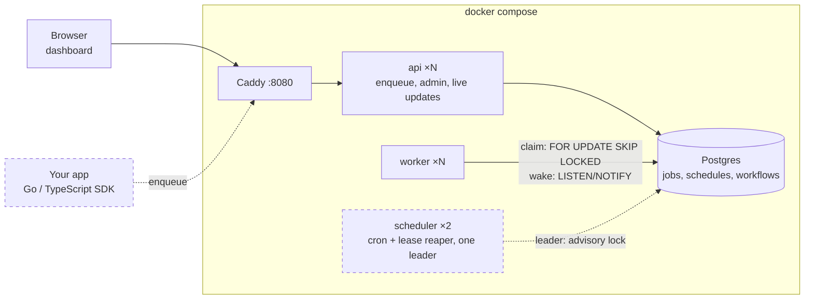

# Job queue and workflow engine

A Postgres-backed job queue with retries, cron schedules, multi-step workflows and a live dashboard.

The step-by-step build plan is in [PLAN.md](PLAN.md).

> **Status:** phase 1 of 8, the core queue. Jobs can be enqueued, claimed and run. Retries, the lease
> reaper, cron, workflows and the dashboard aren't built yet, so a job whose worker crashes stays `running`
> until phase 2 adds the reaper. The API has no authentication yet: don't expose it publicly.

## Run it

```bash
git clone --recurse-submodules https://github.com/gonzalo-gigena/job-queue.git
cd job-queue
cp .env.example .env
docker compose up --watch
```

Open http://localhost:8080. Needs only Docker with Compose v2. Code changes reload
automatically (Compose Watch). On Windows, clone inside the WSL filesystem, not `/mnt/c`.

Cloned without `--recurse-submodules`? Run `git submodule update --init`.

## Use it

```bash
curl -X POST localhost:8080/api/jobs -d '{"kind":"sleep","payload":{"ms":200},"idempotency_key":"demo-1"}'
curl localhost:8080/api/jobs/1
```

`POST /api/jobs` returns `201 {"id":…}`, or `200 {"id":…,"duplicate":true}` when the queue already has that
`idempotency_key`.

| Field | Default | Notes |
|---|---|---|
| `kind` | required | Built in: `noop`, and `sleep` with `{"ms":…}`. An unknown kind fails the job. |
| `payload` | `{}` | Any JSON, up to 1 MB |
| `queue` | `default` | `[a-z0-9_]`, up to 50 characters. Workers serve the queues in `WORKER_QUEUES`. |
| `priority` | `0` | Higher runs first |
| `run_at` | now | RFC 3339 time. A future job starts within about 1 s of it (the poll interval). |
| `max_attempts` | `5` | Stored now, used by phase 2's retries |
| `idempotency_key` | none | 1 to 255 bytes, unique per queue |

A worker runs one job at a time, for up to 24 s. Add workers with `--scale worker=N`.

## Everyday commands

| What | Command |
|---|---|
| Seed demo data | `docker compose run --rm seed` |
| SQL shell | `docker compose exec db psql -U app app` |
| Scale the api | `docker compose up -d --scale api=3` |
| Scale the workers | `docker compose up -d --scale worker=3`, check with `sh infra/worker-smoke.sh 3` |
| Measure enqueue → handled | `docker compose --profile loadtest run --rm k6 run /scripts/latency.js` |
| Prove scaling works | `sh common/scripts/smoke.sh 3` |
| The api replica check from CI | `sh common/scripts/ci-stack.sh 3` (ends with `down -v`) |
| Load test at 1, 2, 4 replicas | `sh common/scripts/scale.sh` |
| Metrics (Prometheus) | `docker compose --profile observability up -d`, then http://localhost:9090 |
| Tests, against real Postgres | `docker compose run --rm test` |
| New migration | add `infra/db/migrations/00000N_name.up.sql` + `.down.sql`, restart |
| Update shared code | `git submodule update --remote common` |
| Reset everything | `docker compose down -v` |

## Architecture



Solid boxes and arrows run today. Dashed ones are planned in [PLAN.md](PLAN.md).

Postgres is the only stateful service. Workers claim jobs with `FOR UPDATE SKIP LOCKED`, so any number of them pull from one table without waiting on each other.

## Stack

- **api:** Go 1.27 (`net/http` + `pgx` + Prometheus client), distroless runtime image. Stateless, so it scales with `--scale api=N`.
- **worker:** the same binary run as `api worker`. It has one direct connection for `LISTEN` (`DIRECT_DATABASE_URL`,
  which defaults to `DATABASE_URL`) and a pool for everything else.
- **Caddy:** the only service with a host port. It load-balances `/api/*` across every
  replica (`import lb api 8080`, from common) and serves `apps/web`.
- **Postgres 18:** migrations run once before the api starts (`golang-migrate`).
- **common/:** git submodule with the shared fakes, scripts, Caddy snippet and Prometheus.
  See [portfolio-common](common/README.md).

## Deploy (one VM)

```bash
docker compose -f compose.yaml -f compose.prod.yaml up -d
```

The server's `.env` needs `SITE_ADDRESS`, `IMAGE_REPO`, `TAG`, a strong password, and no `fakes`
profile. Caddy gets TLS automatically. CI pushes multi-arch images to GHCR on every merge to `main`.

## Decisions & tradeoffs

| Decision | Chosen | Rejected | Why, and what it costs |
|---|---|---|---|
| Broker | Postgres only | Redis (Sidekiq-style), RabbitMQ, Kafka | A job can be enqueued in the same transaction as the app's own write, so it exists exactly when the data does. One stateful service to run and back up. Cost: one Postgres node caps throughput, roughly thousands of jobs/s depending on job size. |
| Claiming jobs | One `UPDATE … WHERE id = ANY(ARRAY(SELECT … FOR UPDATE SKIP LOCKED LIMIT n))` | `SELECT` then `UPDATE`, an advisory lock per job, or the common `id IN (SELECT …)` | One round trip, and concurrent workers skip rows another worker holds instead of queueing behind them. `IN` looks the same, but Postgres may re-scan it and lock more rows each time: on 18 it claimed 5 jobs with `LIMIT 1`. `ARRAY(…)` is evaluated once. |
| Dequeue index | `queue = $1` when a worker serves one queue | Always `queue = ANY($1)` | With `ANY`, Postgres sorts every queued row on each claim (about 12 ms at 50,000 queued) instead of reading the partial index in order (under 1 ms). Cost: a worker with several queues still pays for the sort. |
| Waking workers | `LISTEN/NOTIFY` in the enqueue transaction, plus a 1 s poll | Polling only | Jobs start within milliseconds, and polling catches a missed notification. Cost: `LISTEN` needs a direct connection per worker, not PgBouncer. |
| Delivery guarantee | At-least-once, with leases and a heartbeat | Claiming exactly-once | Exactly-once isn't possible once a worker can die mid-job. Leases fence out zombie workers, and handlers must be idempotent: write a `processed(job_id)` row in the same transaction as the side effect. |
| Retries | Exponential backoff with full jitter, then a dead-letter state | A fixed delay | Jitter stops failed jobs from retrying in lockstep against a struggling dependency. |
| Scheduler leader | `pg_try_advisory_lock` on a direct connection | etcd or Raft, or one scheduler | If the leader dies, its connection closes and the lock frees. Each run's idempotency key (`schedule_id:time`) makes a brief two-leader overlap harmless. |
| Workflow fan-in | Mark the step done and enqueue its children in one transaction, holding the run's row lock | Separate updates | Without the lock, two parents finishing at once each see the other still running, and the child never starts. |
| Packaging | One Go binary with `api`, `worker` and `scheduler` subcommands | A separate image per role | One Dockerfile, one image, and the same version everywhere. |
| Load balancing | Caddy `dynamic a` upstreams (the `lb` snippet in `common/`) | `reverse_proxy api:8080`, Traefik | Caddy re-reads Docker DNS every 5 s, so `--scale api=N` needs no config change and no Docker socket mount. A plain `reverse_proxy api:8080` is a single upstream to Caddy and doesn't reliably spread load. |
| Migrations | A one-shot `migrate` service that finishes before the api starts | Each replica migrating on boot | Replicas starting together would race on the same migration. |

Rows for parts that aren't built yet record the plan's choice. Each one gets confirmed or revised when that phase is built.

## Scaling

### Measured

**Enqueue → handled, idle queue.** `infra/loadtest/latency.js` sends 200 `noop` jobs, one at a time, 150–350 ms
apart, so every worker is asleep in `LISTEN` when a job arrives. *Handled* is `finished_at - created_at` on the
Postgres clock. *Round trip* is what a client sees through Caddy, from sending the POST to a polled GET that
says `succeeded`.

**On an idle system a job is handled 1 ms after enqueue at p50 and 2 ms at p95**, against a target of under
50 ms. That's [one CI run](https://github.com/gonzalo-gigena/job-queue/actions/runs/44981277382) at commit `14b00b3`, with 3 workers on a GitHub-hosted `ubuntu-26.04` amd64
runner that ran nothing else:

| | p50 | p95 | p99 | max |
|---|---|---|---|---|
| handled | 1 ms | 2 ms | 4 ms | 7 ms |
| round trip | 4 ms | 5 ms | 9 ms | 10 ms |

The script compares whole milliseconds, so each value is ±1 ms.

For comparison, under load on an Apple M1 laptop (8 CPUs, 8 GB for Docker). **This machine was not idle:** other projects' stacks shared
the Docker VM, one of them using up to 4 cores, and the host's load average was 12–21. All eight runs:

| workers | run | handled p50 | handled p95 | handled p99 | round trip p50 | round trip p95 |
|---|---|---|---|---|---|---|
| 1 | 1 | 3 ms | 22 ms | 54 ms | 8 ms | 40 ms |
| 1 | 2 | 3 ms | 12 ms | 26 ms | 8 ms | 22 ms |
| 1 | 3 | 10 ms | 59 ms | 121 ms | 23 ms | 127 ms |
| 1 | 4 | 7 ms | 27 ms | 40 ms | 17 ms | 51 ms |
| 3 | 1 | 8 ms | 24 ms | 33 ms | 16 ms | 47 ms |
| 3 | 2 | 24 ms | 88 ms | 103 ms | 38 ms | 100 ms |
| 3 | 3 | 12 ms | 75 ms | 110 ms | 23 ms | 91 ms |
| 3 | 4 | 7 ms | 47 ms | 111 ms | 17 ms | 81 ms |

The median stayed under 50 ms in every run. The p95 went over in three of the eight, so under heavy CPU
contention the target doesn't hold at p95. CI runs the same script on every PR and fails above 50 ms at p95.

**HTTP, from the skeleton:** k6 with 20 virtual users for 20 s against `GET /api/hello`, which reads one row from Postgres through Caddy. Run on an Apple M1 laptop with 8 CPUs and 8 GB given to Docker, with the dev override left out:

```bash
COMPOSE_FILE=compose.yaml sh common/scripts/scale.sh
```

| api replicas | req/s | p95 latency | failed |
|---|---|---|---|
| 1 | 13,526 | 3.09 ms | 0.00% |
| 2 | 14,438 | 2.96 ms | 0.00% |
| 4 | 14,468 | 3.06 ms | 0.00% |

4 replicas served 1.1× the requests of 1. One Go process already spreads across every core, and the run shares 8 CPUs with Caddy, Postgres and k6, so on one machine extra api replicas buy redundancy, not throughput. Replica counts matter for `worker`, which phase 7 measures.

### How each part scales

| Part | Scales by | Limit |
|---|---|---|
| `api` | `--scale api=N` (stateless) | Postgres connections |
| `worker` | `--scale worker=N`, one job at a time each | Throughput grows until Postgres saturates. Phase 5 adds per-queue concurrency and rate limits that hold across replicas. |
| `scheduler` | 2 replicas, one leader | Only the leader works. The standby takes over within ~5 s. |
| Postgres | One primary | The ceiling for the whole system |

### Where it breaks next

- **The dequeue query on a busy Postgres.** First: PgBouncer for workers (transaction mode), a 0–50 ms random delay after each NOTIFY so idle workers don't all query at once, and archiving finished jobs to a day-partitioned table so the hot table stays small and vacuum keeps up.
- **Past one Postgres node.** Shard queues across databases, or move to Kafka or NATS. Portfolio-scale load never gets there.

Phase 7 adds the real test: jobs/s at 1, 2, 4 and 8 workers with no-op jobs and with 50 ms jobs (`REPLICAS="1 2 4 8" SERVICE=worker`).
